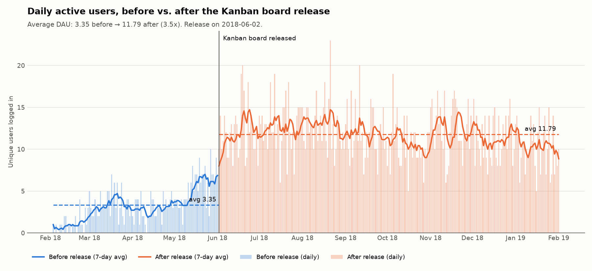

# Shiptivity: Working as a Software Engineer at a Startup

My work for Y Combinator's **"Working as a Software Engineer at a Start Up"** job simulation on Forage (completed October 2026).

Shiptivity is a fictional logistics startup with a Kanban board for shipping requests. The simulation had three tasks across the stack: a frontend feature, the backend that persists it, and an analysis of how the release affected usage.

| Folder | Task | Stack | My change |
|---|---|---|---|
| [`frontend/`](frontend) | Drag-and-drop swimlanes | React, Dragula | [`src/Board.js`](frontend/src/Board.js) |
| [`backend/`](backend) | Persist card status and priority | Node.js, Express, SQLite | [`server.js`](backend/server.js) |
| [`analytics/`](analytics) | Measure the Kanban release and propose features | SQL, Python, matplotlib | [`answer.sql`](analytics/answer.sql), [`INSIGHTS.md`](analytics/INSIGHTS.md) |

The first commit imports the starter code provided by Forage, so each later commit shows exactly what I changed.

---

## Key findings



- **Daily active users rose 3.5x after the release** (3.35 → 11.79 average DAU), or **2.2x** on a like-for-like 30-day window either side of launch.
- **Stickiness is low:** about 78 users log in each month but only about 12 on a given day (**DAU/MAU ≈ 15%**).
- **The board is going stale:** 46 of 58 in-progress cards haven't moved in over 14 days, and the change history has no `user_id`, so card activity can't be tied to users.

From this I proposed three features, in build order: card owners and activity feed (which also adds the missing tracking), a daily digest with stale-card nudges, and an invite-teammates loop. Full analysis, metrics and wireframes are in [`analytics/INSIGHTS.md`](analytics/INSIGHTS.md).

---

## 1. Frontend: drag-and-drop swimlanes

Sales needed to move shipping requests between **Backlog → In Progress → Complete**.

- Wired Dragula to the three swimlanes.
- On drop, Dragula's DOM move is cancelled and the change goes through React state instead, so React stays the single source of truth. Cards keep their position relative to the card they were dropped next to, and are recolored by status.

## 2. Backend: persisting card moves

`PUT /api/v1/clients/:id` accepts `{ status, priority }` and saves the move to SQLite.

- **Validation:** rejects unknown statuses and non-positive priorities with `400`.
- **Consistent ordering:** the affected swimlanes are renumbered 1..n, so priorities stay unique with no gaps, whether a card is reordered within a lane or moved across lanes.
- **Atomic writes:** all updates run in one transaction, so a failure can't leave the board half-updated.
- **Bug fix:** the starter handlers sent a `400` for an invalid id but kept running and tried to send a second response. They now return early.

```bash
curl -X PUT http://localhost:3001/api/v1/clients/1 \
  -H "Content-Type: application/json" -d '{"status":"complete","priority":3}'
```

## 3. Analytics: did the Kanban board work?

- **DAU before vs. after**, using a recursive calendar CTE so days with zero logins still count toward the averages.
- **A 30-day comparison window** either side of launch, to separate the release's effect from early-2018 growth.
- **Status changes per card, per day and by type of move**, excluding the creation event and keeping never-moved cards at zero.
- [`scripts/generate_charts.py`](analytics/scripts/generate_charts.py) runs the same tagged queries from `answer.sql` to draw the charts, so the numbers and charts can't drift apart.

---

## Running it

```bash
# Analytics
cd analytics
sqlite3 shiptivity.db < answer.sql
pip install matplotlib && python scripts/generate_charts.py

# Backend (port 3001)
cd backend && npm install && npm start

# Frontend (port 3000)
cd frontend && npm install && npm start
```

> The starter projects pin 2019-era dependencies (`react-scripts` 2, `better-sqlite3` 5). On a recent Node version you may need Node 12/14 via `nvm`, or `NODE_OPTIONS=--openssl-legacy-provider` for the frontend.

---

## Certificate


Starter code and dataset © Forage / Y Combinator, used here for the job simulation.
