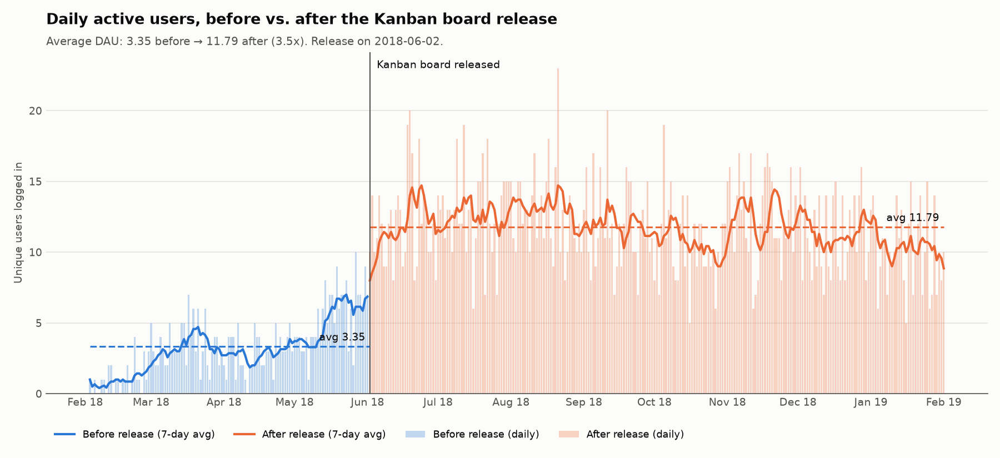
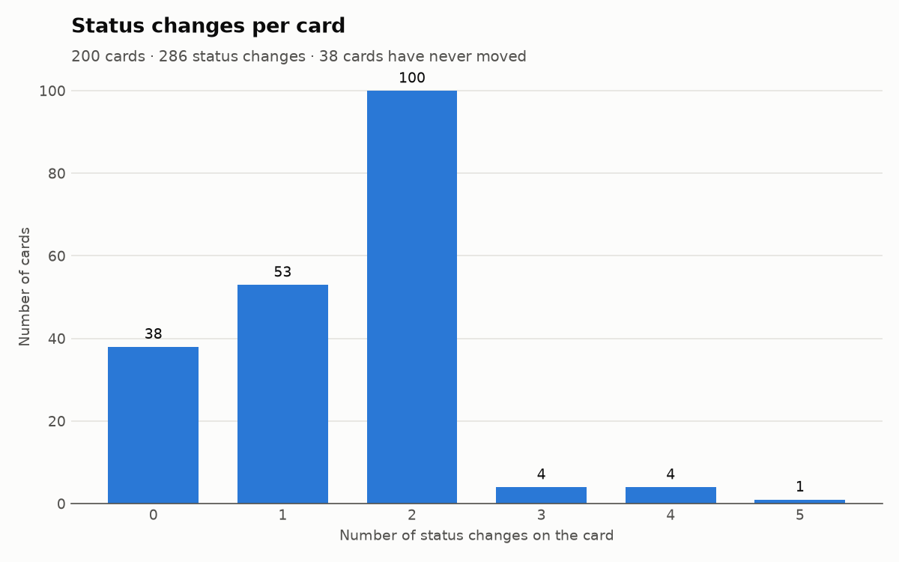
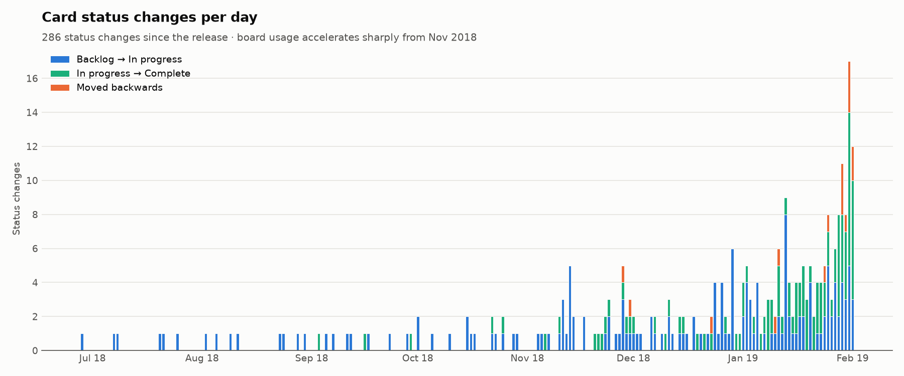
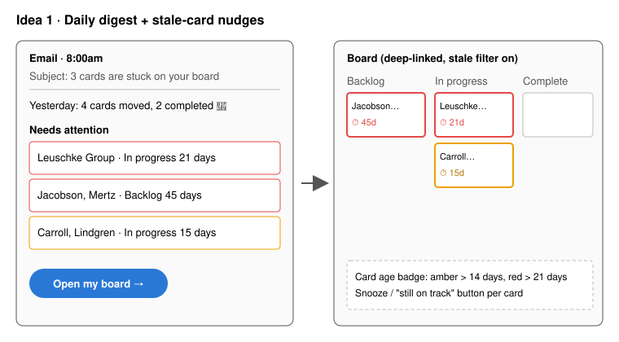
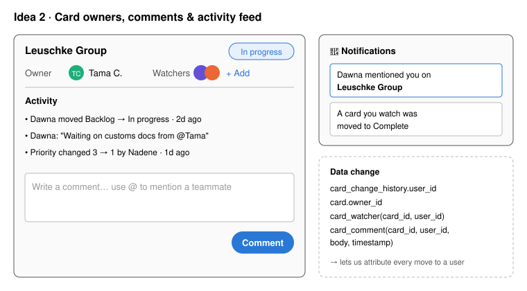
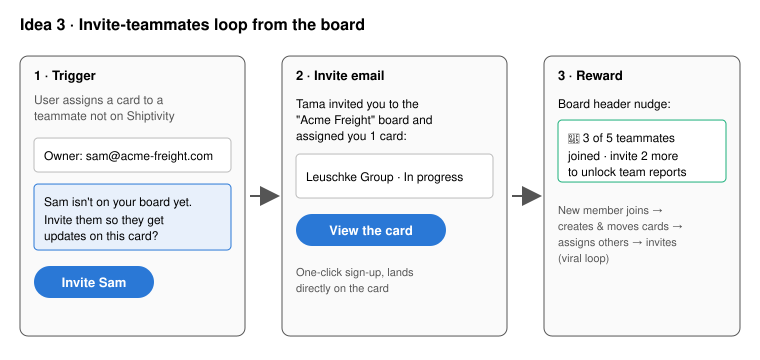

# Kanban board release: analysis & next ideas

**Release date:** 2018-06-02 · **Data window:** 2018-02-03 → 2019-02-01 · **Source:** `shiptivity.db`

All numbers below come from the queries in [`answer.sql`](answer.sql). Charts are produced by
[`scripts/generate_charts.py`](scripts/generate_charts.py), which runs those same queries:

```bash
python scripts/generate_charts.py      # needs matplotlib
sqlite3 shiptivity.db < answer.sql     # or run the raw SQL directly
```

---

## 1. Daily active users before vs. after the release



| Period | Days | Avg DAU | Peak DAU |
|---|---|---|---|
| Before (2018-02-03 → 2018-06-01) | 119 | **3.35** | 10 |
| After (2018-06-02 → 2019-02-01) | 245 | **11.79** | 23 |
| 30 days before (2018-05-03 → 06-01) | 30 | 5.63 | |
| 30 days after (2018-06-02 → 07-01) | 30 | 12.17 | |

**What it says**

- DAU went up **3.5x** after the release (2.2x on a like-for-like 30-day window), so the board clearly worked.
- Most of that came from new users: **43 of 100 users had their first login in June 2018**. Since September
  we've added roughly **one new user a month**, so growth has stalled.
- After the release, DAU peaked in Jul–Aug (avg 12.9) and has **slipped about 20% to 10.2 in Jan 2019**.
- Stickiness is low. About 78 users log in each month but only about 12 log in on a given day
  (**DAU/MAU ≈ 15%**), which means a typical user visits about once a week.

## 2. Status changes by card





**What it says**

- There are **286 status changes across 200 cards**. The first history row for each card is its creation and isn't counted.
- **38 cards (19%) have never moved** and 53 have moved only once. Just 9 cards have moved more than twice.
- Cards move slowly. On average a card waits **66 days in Backlog** before it's started and then
  takes **35 days from In progress to Complete**.
- A lot of the board is stale. **46 of the 58 In-progress cards** haven't changed in more than 14 days, and
  **35 of the 44 Backlog cards** haven't changed in more than 30 days.
- Board usage is picking up: there were 149 status changes in Jan 2019, against 47 in Dec and fewer than 15 a month before Oct.
  The people who stay are using the board more, even though the number of daily users is going down.
- `card_change_history` has **no `user_id`**, so we can't tell *who* moves cards. That makes it hard
  to tie board actions to DAU.

---

## 3. Three ideas to move DAU

### Idea 1: Daily digest + stale-card nudges



**Hypothesis**
Users log in about once a week (DAU/MAU ≈ 15%) and most cards sit untouched for weeks. If we email a short daily
summary that shows what moved yesterday and which cards are stuck, and each card links straight to
the board, users will have a reason to come back every day. Cards will also move faster.

**Expected impact**
- DAU/MAU goes from 15% to 20% or more, roughly +4 DAU on today's base.
- The share of In-progress cards that haven't been touched in over 14 days drops from 79% to under 50%.
- Average time from In progress to Complete drops from 35 days to under 25.

**What the feature is**
An opt-out 8am email (and in-app banner) that lists yesterday's moves and the top 3 "needs attention" cards.
On the board, each card gets an age badge (amber after 14 days, red after 21). Clicking a card in the email
opens the board with a stale filter on. Each card has a "still on track" snooze so the nudges don't get
annoying.

---

### Idea 2: Card owners, comments & activity feed



**Hypothesis**
The board is a solo tool right now, because a card has no owner, no comments and no record of who moved it. If
cards have owners and watchers, and every move or @mention sends a notification, then each action one
person takes gives a teammate a reason to log in. Collaboration loops like this are what keep work tools
in daily use.

**Expected impact**
- +15–25% DAU, driven by notification-triggered sessions. We'd measure the share of sessions that start from a notification.
- Cards that have an owner move at least 1.5x more often than cards that don't.
- We can finally attribute every card change to a user, which unlocks per-user engagement metrics for future work.

**What the feature is**
Each card gets an owner and optional watchers, plus a comment thread with @mentions and an activity log of moves
and priority changes. Owners and watchers get in-app and email notifications when the card moves or they're mentioned.
On the schema side, we'd add `user_id` to `card_change_history`, `owner_id` to `card`, and new
`card_watcher` and `card_comment` tables.

---

### Idea 3: Invite-teammates loop from the board



**Hypothesis**
New users jumped right after the launch (43 first logins in June) and then dropped to about one a month,
and DAU can't keep growing without new users. Every shipment involves several people. If users can assign a card
to someone who isn't on Shiptivity yet, and that person gets an invite that opens directly on the card,
current users will bring in teammates for us.

**Expected impact**
- New users go from about 1 a month to at least 10 a month (an invite-acceptance target of 30% or more).
- A larger user base in the same accounts makes Ideas 1 and 2 more effective, since there are more people to notify.
- If teams of 3 or more retain better than solo users, which we should validate, this also lifts DAU/MAU.

**What the feature is**
When a user types an email address that isn't registered into the card owner field, they're asked to invite that
person. The invite email names the person who sent it and shows the card. Sign-up is one click and lands on that card.
A board-header progress nudge ("3 of 5 teammates joined") rewards teams that invite more people, for example by
unlocking team reports.

---

## Recommended order

1. **Idea 2 first.** It adds the `user_id` instrumentation we need to measure everything else, and the other two ideas build on it.
2. **Idea 1 second.** It costs little to build, can be A/B tested on the digest email, and directly targets the DAU/MAU gap.
3. **Idea 3 third.** It uses card ownership from Idea 2 to restart new-user growth.
